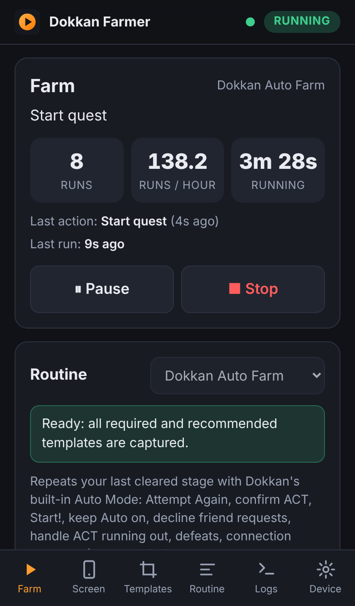
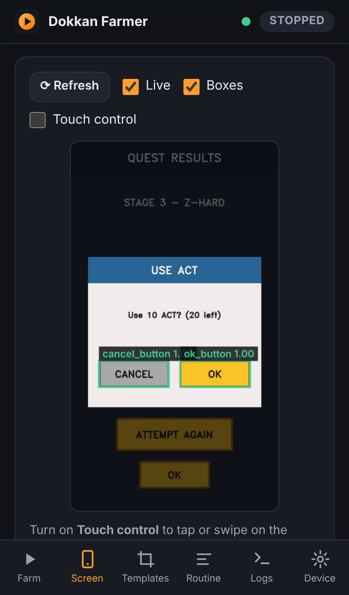
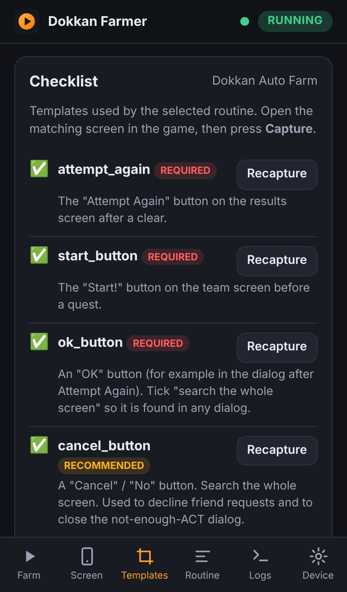

# Dokkan Idle Farmer

[](https://github.com/flavio-code-535345/dragon-ball-dokhan-battle-idle-farmer/actions/workflows/ci.yml)
[](https://hub.docker.com/r/flavio11113/dokkan-idle-farmer)

A self-hosted idle farmer for **Dragon Ball Z Dokkan Battle** that runs as a Docker container
(Portainer-ready) on your home server. It drives an Android phone, an emulator, or Android running
in a container on the same server (all-in-one stack) over ADB, keeps Dokkan's own **Auto Mode**
farming your stage around the clock, and you watch and control everything from a mobile-friendly
web page.

<p align="center">
  
  
  
</p>

> [!WARNING]
> Unofficial fan project, not affiliated with or endorsed by Bandai Namco Entertainment or
> Akatsuki. **Automating the game breaks Dokkan Battle's terms of service and can get your account
> banned.** Use it at your own risk, on your own account. The project ships no game assets: the
> button images it looks for are screenshots *you* capture from *your* game.

## How it works

Dokkan has a built-in **Auto Mode** that plays the map and the battles of any difficulty you have
already cleared ([about Auto Mode](https://dokkaninfo.com/news/200760)). What it does not do is
start the next run, close popups, deal with ACT running out, or recover from errors and crashes.
That's this project's job:

```
 your phone's browser ──► farmer container (web UI :8080) ──ADB──► Android device running Dokkan
                              screenshot → find buttons (OpenCV) → tap
```

About once a second the farmer takes a screenshot, looks for the buttons you taught it ("templates")
and fires the first matching rule of a **routine**: tap *Attempt Again*, confirm the ACT dialog,
press *Start!*, turn *Auto* on, decline the friend request, and so on. Everything else is the game's
own Auto Mode, so the farmer is simple and does not try to play battles itself.

## Features

- **Docker / Portainer native**: one container, a volume for your data, prebuilt multi-arch image
  on Docker Hub (amd64 + arm64, e.g. Raspberry Pi), healthcheck, runs as non-root (`PUID`/`PGID`).
- **Mobile web UI** (add it to your home screen): start/pause/stop, live screen with the detected
  buttons, **remote touch control** of the device, logs, statistics.
- **Template studio**: drag a box around a button on a live screenshot to teach it. A checklist shows
  what the routine needs, and "Test on screen" shows match scores.
- **Default routine for Dokkan's Auto Mode farm loop**, configurable from the UI:
  - stop after N runs,
  - what to do when **ACT** runs out: wait for it to regenerate, use ACT items, spend a limited
    number of Dragon Stones, or stop,
  - after a **defeat**: always "Give up" (never a paid revive), then stop or continue,
  - decline friend requests, retry connection errors, tap through "tap to continue" screens.
- **Self-healing**: relaunches Dokkan if it crashes or loses focus, navigates back to your stage
  (optional templates), resumes interrupted quests, detects stuck screens (BACK, then a game
  restart, then gives up with a notification), pauses rules that have no effect, wakes the screen,
  reconnects to the device with back-off.
- **Active hours** (e.g. only farm at night), **autostart/resume** after a host reboot.
- **Notifications** to Discord, Telegram, ntfy, Gotify, e-mail and [many more](https://github.com/caronc/apprise/wiki)
  (via Apprise), with a screenshot when something goes wrong.
- **Routines are YAML** and can be edited in the browser, so you can write your own (event medals,
  EZA, ...). See [docs/ROUTINES.md](docs/ROUTINES.md).
- **Demo mode** with a built-in fake game (`DEVICE_BACKEND=sim`), so you can try the UI without a phone.

## Quick start with Portainer

**1. Prepare an Android device with ADB over the network.** The easiest is a spare phone or
tablet on Wi-Fi with *Wireless debugging* (Android 11+). Emulators on a PC work too. No spare
device? Run Android on the server itself with the [all-in-one stack](#all-in-one-android-on-the-server).
See **[docs/DEVICE_SETUP.md](docs/DEVICE_SETUP.md)**.

**2. Deploy the stack.** In Portainer go to *Stacks → Add stack*:
- **Repository** build method:
  - Repository URL: `https://github.com/flavio-code-535345/dragon-ball-dokhan-battle-idle-farmer`
  - Repository reference: `refs/heads/main`
  - Compose path: `docker-compose.yml`
- or paste [`docker-compose.yml`](docker-compose.yml) into the **Web editor**.

Add environment variables (all optional, see [.env.example](.env.example)), for example:

| Variable | Example |
|---|---|
| `ADB_SERIAL` | `192.168.1.50:5555` |
| `WEB_PASSWORD` | something long |
| `TZ` | `Europe/Rome` |
| `NOTIFY_URLS` | `tgram://123456:ABC/987654` |

**3. Open `http://<your-server>:8080` on your phone.** In the **Device** tab, connect to your device
(or pair it first: Android's *Pair device with pairing code* dialog works from the web UI).

**4. In Dokkan**: clear the stage you want to farm once, switch **Auto** on, and finish a run so
you are on the results screen with the *Attempt Again* button.

**5. Templates tab**: capture the three **required** templates (*Attempt Again*, *Start!*, *OK*)
when they are on screen. Add the **recommended** ones (Cancel, not-enough-ACT dialog, friend
request, Auto OFF, Retry, Give up) as soon as you meet them. Tips: [docs/TEMPLATES.md](docs/TEMPLATES.md).

**6. Farm tab**: choose the options and press **Start farming**.

Without Portainer it is the same with plain Docker Compose:

```sh
curl -O https://raw.githubusercontent.com/flavio-code-535345/dragon-ball-dokhan-battle-idle-farmer/main/docker-compose.yml
ADB_SERIAL=192.168.1.50:5555 WEB_PASSWORD=change-me docker compose up -d
```

> [!NOTE]
> The compose files pull [`flavio11113/dokkan-idle-farmer`](https://hub.docker.com/r/flavio11113/dokkan-idle-farmer)
> from Docker Hub, built by GitHub Actions (see [Publishing the image](#publishing-the-image)).
> The same image is on GitHub's registry: set
> `IMAGE=ghcr.io/flavio-code-535345/dragon-ball-dokhan-battle-idle-farmer` to use it (make that
> package public first if Portainer can't pull it). Or deploy
> [`docker-compose.build.yml`](docker-compose.build.yml), which builds the image on your server.

## All-in-one: Android on the server

No spare phone? Run Android in a container next to the farmer, so nothing else has to stay on:

- [`docker-compose.emulator.yml`](docker-compose.emulator.yml): Google's Android emulator,
  Android 11 **with Google Play**. Needs `/dev/kvm`; on Proxmox (Docker in an LXC container) run
  `pct set <CTID> -dev0 /dev/kvm,mode=0666 && pct reboot <CTID>` on the host first. Tested: the
  [emulator end-to-end workflow](.github/workflows/emulator-e2e.yml) installs Dokkan through the
  farmer and the game starts.
- [`docker-compose.redroid.yml`](docker-compose.redroid.yml): redroid, Android 14 without Google
  Play. Lighter, but needs a Linux host where Docker may load the kernel's binder driver.

Deploy one of them instead of `docker-compose.yml` (no `ADB_SERIAL` needed), install Dokkan from
the Play Store (emulator) or through the Device tab's *Apps* card (redroid), and continue with
step 4 above. Details: [docs/DEVICE_SETUP.md, option C](docs/DEVICE_SETUP.md#c-all-in-one-android-on-the-server).

## Configuration

All settings are environment variables:

| Variable | Default | Description |
|---|---|---|
| `ADB_SERIAL` | *(empty)* | Device address such as `192.168.1.50:5555` (empty = the only USB device). Can also be changed in the UI. |
| `GAME_PACKAGE` | `global` | `global` (`com.bandainamcogames.dbzdokkanww`), `jp` (`com.bandainamcogames.dbzdokkan`) or any package name. |
| `DEVICE_BACKEND` | `adb` | `sim` = built-in demo game instead of a real device. |
| `ROUTINE` | `dokkan_auto_farm` | Routine used by autostart before one was picked in the UI. |
| `AUTOSTART` | `resume` | `resume`: keep farming after a restart if it was farming. `true`: always start. `false`: never start. |
| `ACTIVE_HOURS` | *(always)* | Daily windows, e.g. `23:00-07:00, 13:00-14:00` (uses `TZ`). |
| `TZ` | `UTC` | Time zone, e.g. `Europe/Berlin`. |
| `WEB_USERNAME` / `WEB_PASSWORD` | `admin` / *(empty)* | HTTP basic auth for the web UI. **Set a password.** |
| `HOST_PORT` | `8080` | Port on your server (compose files only). |
| `IMAGE` / `IMAGE_TAG` | `flavio11113/dokkan-idle-farmer` / `latest` | Image to run (compose files only): a version like `0.1.0` or a commit SHA pins it. |
| `NOTIFY_URLS` | *(empty)* | [Apprise URLs](https://github.com/caronc/apprise/wiki), space or comma separated. |
| `NOTIFY_EVERY_RUNS` | `0` | Also send a progress message every N runs. |
| `KEEP_SCREEN_ON` | `true` | Enable "stay awake" on the device while farming. |
| `MATCH_SCALE` | `0.5` | Downscaling for template matching (lower = faster, less precise). |
| `TAP_JITTER` | `0.15` | Random tap offset inside a button, as a fraction of its size. |
| `SCREENSHOT_KEEP` | `30` | Debug screenshots kept in `/data/screenshots` (stuck screens, defeats). |
| `PUID` / `PGID` | `1000` | Owner of the files in the data volume. |
| `RUN_AS_ROOT` | `false` | Needed for USB passthrough (`/dev/bus/usb`). |
| `LOG_LEVEL` | `INFO` | `DEBUG` for more detail. |
| `ANDROID_MEMORY` / `ANDROID_CORES` | `6144` / `4` | Emulator stack: RAM (MB) and CPU cores of the emulated Android. |
| `ANDROID_FPS` | `30` | Emulator stack: Android's screen refresh rate (60 = smoother, more CPU). |
| `EMULATOR_CONSOLE` | *(empty)* | Emulator stack: the emulator's console (`android:5554`) for fast screenshots, through the shared folder `EMULATOR_SCREENSHOTS` (`/screens`). |
| `EMULATOR_IMAGE` | `halimqarroum/docker-android:api-30-playstore` | Emulator stack: the emulator image. Keep API 30 (ARM translation). |
| `REDROID_GPU_MODE` | `guest` | redroid stack: `guest` renders on the CPU, `host` on the server's Intel/AMD GPU. |
| `REDROID_FPS` | `30` | redroid stack: Android's frame rate (lower = less CPU). |
| `REDROID_IMAGE` | `redroid/redroid:14.0.0-latest` | redroid stack: the Android image. Keep 14 on x86_64 (ARM translation). |

Everything you configure in the UI (templates, routines, options, device address, statistics)
lives in the `/data` volume.

## Notifications

Set `NOTIFY_URLS` to one or more [Apprise](https://github.com/caronc/apprise/wiki) URLs, for example
`tgram://bottoken/ChatID`, `discord://webhook_id/webhook_token` or `ntfy://my-topic`. You get a
message when farming starts or stops, when ACT runs out, when the game had to be restarted (with a
screenshot), when the device is unreachable and, with `NOTIFY_EVERY_RUNS`, every N runs. Use the
*Send test notification* button in the Device tab to check it.

## Routines and templates

- **Templates** are small crops of the screen (a button, a dialog title) captured in the web UI.
  Each has a threshold, a search area (near where it was captured, or the whole screen) and an
  optional colour check. See [docs/TEMPLATES.md](docs/TEMPLATES.md).
- **Routines** are YAML files with options (shown as a form in the UI) and an ordered list of rules
  (`when` this is on screen, `do` these actions). The first matching rule wins. The bundled
  [`dokkan_auto_farm.yaml`](src/dokkan_farmer/routines/dokkan_auto_farm.yaml) is a commented
  example. See [docs/ROUTINES.md](docs/ROUTINES.md).

## Demo mode

Deploy the stack with `DEVICE_BACKEND=sim` (or run
`docker run -p 8080:8080 -e DEVICE_BACKEND=sim flavio11113/dokkan-idle-farmer`)
to get a crude built-in fake game with results screens, ACT dialogs, battles, friend requests,
errors and crashes. Its templates are generated automatically, so you can press Start right away and
see how everything behaves.

## Updating

In Portainer open the stack and use *Pull and redeploy* (or enable automatic updates for
Git-based stacks), or run `docker compose pull && docker compose up -d`. Your data stays in the volume.

## Publishing the image

The **Build + Docker Hub** workflow ([`ci.yml`](.github/workflows/ci.yml)) lints and tests every
push and pull request. On `main`, on `v*` tags and when started by hand, it then builds the image
for amd64 and arm64, smoke-tests it in demo mode and pushes it to:

| Registry | Image | Needs |
|---|---|---|
| Docker Hub | `<DOCKER_USERNAME>/dokkan-idle-farmer` | the `DOCKER_USERNAME` and `DOCKER_PASSWORD` secrets |
| GitHub Container Registry | `ghcr.io/flavio-code-535345/dragon-ball-dokhan-battle-idle-farmer` | nothing (uses the workflow token) |

Tags: `latest` for `main`, the full commit SHA for every build, and `1.2.3` plus `1.2` for a
`v1.2.3` git tag. Pull requests only build and test the image.

To enable Docker Hub, add two repository secrets once: *Settings → Secrets and variables →
Actions → New repository secret*:

- `DOCKER_USERNAME`: your Docker Hub user name,
- `DOCKER_PASSWORD`: a Docker Hub [personal access token](https://docs.docker.com/security/for-developers/access-tokens/)
  with *Read & Write* access (better than your password).

Without them the workflow still publishes to GHCR and shows a notice. The Docker Hub repository is
created on the first push. To use another name, change `DOCKERHUB_REPO` at the top of the workflow
and `IMAGE` in the compose files.

## Troubleshooting

- **Device not connected**: check that the server can reach the phone (same network, no client
  isolation on the Wi-Fi). Wireless debugging changes its port after every reboot or toggle. See
  [docs/DEVICE_SETUP.md](docs/DEVICE_SETUP.md) for a fixed port.
- **"unauthorized"**: accept the *Allow debugging* prompt on the device (tick *Always allow*). The
  adb key is stored in the volume, so you only do this once.
- **Nothing happens / skipped rules**: the Farm tab lists rules skipped because of missing
  templates. Use *Templates → Test on screen* to see the scores. Recapture or lower the threshold
  if a button is not found.
- **It taps the wrong thing**: make the template more distinctive (include the text), uncheck
  "whole screen", or enable colour matching. A popup's dimmed background is ignored automatically.
- **redroid stack does not start**: open the logs of the `host-setup` container. It explains
  what to install, or to use the emulator stack (e.g. Docker in a Proxmox LXC container).
- **Emulator stack: no device**: the `android` container needs `/dev/kvm` (see above); its logs
  show `Boot completed` once Android is up. *"error gathering device information while adding
  custom device /dev/kvm"* means the Docker host (e.g. the Proxmox LXC container) has no
  `/dev/kvm` yet: run the `pct set … -dev0 /dev/kvm` line and reboot the container. Keep the
  `devices: - /dev/kvm` lines in the stack, the emulator cannot start without them.
- **Logs** are in the Logs tab and in `/data/logs/farmer.log`. Screenshots of stuck screens are in
  `/data/screenshots`.

## Similar projects (checked October 2026)

There are several recent Dokkan farming bots. As far as I found, **none runs headless in
Docker/Portainer with a web UI**: they are desktop scripts or apps that need a PC with an emulator
or phone mirroring open.

| Project | What it does | How | Status |
|---|---|---|---|
| [JeSuisJo/Dokkan-Semi-LegitBot](https://github.com/JeSuisJo/Dokkan-Semi-LegitBot) | Replay a stage N times, Z-TUR medal farming (bronze → rainbow), ACT refills | Python, ADB + OpenCV, Windows, emulator at a fixed 1080x800 resolution | active 2026 |
| [SolaneHub/Dokkan-EZALink-Farmer](https://github.com/SolaneHub/Dokkan-EZALink-Farmer) | EZA level-999 Zeni farming, link-skill leveling, Discord remote control | Python, ADB + scrcpy + OpenCV/OCR, Windows-first | active 2026 |
| [feijoes/dokkan_eza_bot](https://github.com/feijoes/dokkan_eza_bot) | EZA farming | Python, image matching, USB phone, Global only | maintained, most starred |
| [9x33/Dokkan-Battle-Auto-Replayer](https://github.com/9x33/Dokkan-Battle-Auto-Replayer) | Presses Attempt Again / OK / Start! between Auto runs | Desktop app on phone mirroring (macOS iPhone Mirroring, Windows) | 2026 |
| [Suussonic/Dokkan-Auto-Player](https://github.com/Suussonic/Dokkan-Auto-Player) | Repeats battles | Windows screen-capture auto-clicker | 2026 |
| [fredericVaquer/dokkan_auto](https://github.com/fredericVaquer/dokkan_auto) | Research: better pathing than the in-game Auto | Simulator, not a bot | 2026 |
| tanukijs/dokkan-bot, pawelorzech/dokkan-battle-bot, jazzrz86/Open-Source-Battle-Bot | Server-API bots | Talked to Dokkan's servers directly | archived / dead, high ban risk |

Be careful with repositories that only offer an `.exe` download from an external site instead of
source code.

## Development

```sh
python -m venv .venv && . .venv/bin/activate
pip install -r requirements-dev.txt
pytest                        # unit + simulator end-to-end tests
ruff check src tests && ruff format --check src tests
DEVICE_BACKEND=sim DATA_DIR=./data PYTHONPATH=src python -m dokkan_farmer   # http://localhost:8080
```

Project layout: `src/dokkan_farmer/` holds `engine.py` (farm loop), `vision.py` (template
matching), `routine.py` (YAML schema), `device/` (ADB backend and simulator), `web/` (FastAPI and
the single-page UI) and `routines/` (bundled routines). The REST API is documented at `/api/docs`.

## License

[MIT](LICENSE). Dragon Ball and Dokkan Battle are trademarks of their respective owners.
